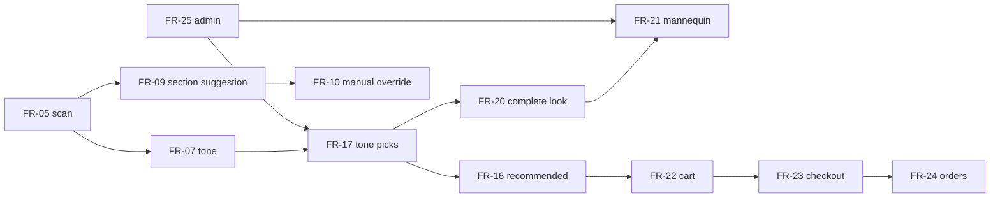

# Chapter 2 — Software Requirements

## 2.1 Purpose

This chapter defines what Wear Right must do, who uses it, the quality attributes it must meet, and where each requirement is implemented and tested. It is the contract used by the design, implementation and evaluation chapters.

## 2.2 Stakeholders

| Stakeholder | Interest |
| --- | --- |
| Shopper / customer | Get a tone reading, useful colour advice and products that suit them. |
| Fashion-shop owner | Convert advice into product discovery and outfit completion. |
| Store staff / admin | Maintain products, categories, colours, tone rules, mannequin layers and orders. |
| FYP supervisor / examiner | See a complete, testable system with evidence and honest limitations. |
| Developer / maintainer | Run, seed, test and extend the system on Windows, Linux or macOS. |

## 2.3 Functional requirements

### 2.3.1 Accounts and profile

| ID | Requirement | Implementation | Evidence |
| --- | --- | --- | --- |
| FR-01 | A visitor can register and log in as a customer. | `accounts/views.py`, `AuthProvider.tsx` | `accounts/tests/`, `AuthProvider.test.tsx` |
| FR-02 | A signed-in customer can view and update profile fields, including gender, sizes, preferred style and skin tone. | `accounts/views.py`, `MeView`, `UserProfile` | `accounts/tests/`, `AuthProvider.test.tsx` |
| FR-03 | Staff authenticate through a separate admin login and cannot use the shopper session by accident. | `staff/views.py`, `staff/urls.py` | `staff/tests/test_rbac.py` |
| FR-04 | Password reset works for both shoppers and staff. | `accounts/views.py`, `staff/views.py`, `core/emails.py` | `accounts/tests/`, `password-reset.test.tsx` |

### 2.3.2 Scan and result

| ID | Requirement | Implementation | Evidence |
| --- | --- | --- | --- |
| FR-05 | A shopper can scan with the camera using several frames or upload one photo. | `FaceScanView.tsx`, `scanner/views.py` | `test_scan_api.py`, e2e `08-scanner-v2` (rewritten, not run) |
| FR-06 | The scanner rejects or warns about poor light, blur, side light and head turn, and explains the fix. | `scanner/engine/quality.py`, `scanner/views.py` | `scanner/tests/test_quality.py`, `test_quality_api.py` |
| FR-07 | The result reports depth, undertone, Monk swatch, confidence and the photo-quality checks. | `scanner/engine/pipeline.py`, `FaceScanView.tsx` | `test_pipeline.py`, `test_scan_api.py` |
| FR-08 | If no face or no usable skin is found, the shopper stays on the scan page, sees the retake reason, and can choose a tone manually. | `FaceScanView.tsx`, `ManualToneAPIView` | `test_scan_api.py`, manual check 5 |
| FR-09 | The scanner suggests the men's or women's section from the face crop, with confidence and reasons, but never forces it. | `scanner/engine/gender.py`, `GenderSuggestion.tsx` | `test_gender.py`, `test_real_models.py` |
| FR-10 | A suggestion below 60% confidence asks the shopper; the result page can change section in place. | `FaceScanView.tsx`, `ResultHeader.tsx` | `ScannerResultView.test.tsx`, manual check |
| FR-11 | A successful scan opens `/scanner/result` after a deliberate 2.2-second analysing screen; a failed scan never shows a result. | `features/scanner/analysing.ts`, `ScannerResultView.tsx` | `analysing.test.ts`, manual checks 2 and 5 |
| FR-12 | The result survives a reload through local storage, and a direct visit without a saved scan redirects to `/scanner`. | `features/scanner/savedScan.ts` | `ScannerResultView.test.tsx`, manual check 6 |
| FR-13 | The result shows a Fair/Medium/Dark headline, a swatch, an undertone chip and a confidence word, not a raw percentage. | `ResultHeader.tsx` | `ScannerResultView.test.tsx` |
| FR-14 | “Not right? Choose mine” switches the tone in place using the existing manual endpoint and refreshes the picks. | `ScannerResultView.tsx`, `ManualToneAPIView` | `ScannerResultView.test.tsx`, e2e 8b (rewritten) |

### 2.3.3 Recommendation and outfit

| ID | Requirement | Implementation | Evidence |
| --- | --- | --- | --- |
| FR-15 | The shop lists active, in-stock products with category, style, colour, gender, size and price filters. | `catalog/views.py`, shop components | `catalog/tests/`, e2e route suite |
| FR-16 | `/recommended` ranks products by palette, style and preference, and honours the chosen gender. | `recommender/engine/ranker.py`, `RecommendedProductsView.tsx` | `test_ranker.py`, `test_recommender_api.py`, web tests |
| FR-17 | `GET /api/recommendations/tone-picks/` returns four groups with up to two picks for one gender and tone. | `engine/tone_picks.py`, `TonePicksAPIView` | `test_tone_picks.py` |
| FR-18 | Gender is a hard filter; a men's request never returns a women's product, and unisex products may serve both. | `tone_picks.py`, selector | `test_tone_picks.py` |
| FR-19 | Tone picks are deterministic, prefer best/good colours, avoid avoid-colours when alternatives exist, vary colour families and flag short groups. | `engine/tone_picks.py` | `test_tone_picks.py` |
| FR-20 | A product can be completed into a look with the missing slots, and the look explains each pairing. | `engine/looks.py`, `CompleteOutfitView.tsx` | `test_looks.py`, `CompleteOutfitView.test.tsx` |
| FR-21 | The layered mannequin draws the selected garments by gender and skin tone, with a fallback when a layer or base is missing. | `catalog/alpha_selectors.py`, `dressingRoom.ts` | `dressingRoom.test.ts`, manual mannequin checks |
| FR-22 | The shopper can add products to the cart, change quantities, merge a guest cart and see the total. | `orders/views.py`, `useCart` | `useCart.test.tsx`, API tests |
| FR-23 | Demo checkout supports cash on delivery and a clearly labelled demo card; it creates order items and decrements stock. | `orders/services.py` | `orders/tests/` |
| FR-24 | A customer can view order history, open an order and cancel while it is Pending. | `orders/views.py`, order pages | `orders/tests/`, web tests |

### 2.3.4 Administration and operations

| ID | Requirement | Implementation | Evidence |
| --- | --- | --- | --- |
| FR-25 | Staff manage products, categories, colours, styles, tone rules and mannequin layers. | `staff/views.py`, `components/admin/*` | `staff/tests/`, `MannequinSection.test.tsx` |
| FR-26 | Permissions are role-based and enforced on the server, not only hidden in the UI. | `staff/permissions.py`, `AdminMember` | `test_rbac.py` |
| FR-27 | Staff can see and update order status and view face-scan records without receiving customer passwords. | `staff/views.py` | `test_team_crud.py`, admin tests |
| FR-28 | A read-only audit command prints eligible counts and the two picks for every gender × tone × group. | `audit_tone_picks.py` | `test_tone_picks.py` |
| FR-29 | One npm setup command prepares environment, database, seed data, mannequin, models and build; one npm command starts the demo. | `scripts/wearright.mjs`, `package.json` | manual setup run |
| FR-30 | Product photos and mannequin images are checked for missing files; `check_media` reports them and never silently clears mannequin references. | `check_media.py`, `seed_products.py` | `test_check_media.py`, `test_seed.py` |

## 2.4 Non-functional requirements

| ID | Quality attribute | Requirement | How it is met |
| --- | --- | --- | --- |
| NFR-01 | Usability | A new shopper can complete scan → result without training. | One primary action per state, plain-language errors, manual fallback always visible. |
| NFR-02 | Performance | A scan should return in a few seconds; the analysing screen must not flash. | 2.2 s minimum, server wait honoured; model ~230 ms/frame. |
| NFR-03 | Reliability | A missing gender model or bad photo must never crash the shop. | Exceptions are caught; scan falls back to manual tone; retake card. |
| NFR-04 | Security | Tokens are httpOnly cookies with CSRF protection; permissions are server-side. | `core/authentication.py`, `staff/permissions.py`. |
| NFR-05 | Privacy | Face photos are analysed in memory and are not stored or shown to staff. | No photo field in `FaceScanRecord`; only measurements are stored. |
| NFR-06 | Fairness | Gender is a suggestion, not a fact; the shopper can override it. | Auto suggestion threshold, change-section control, manual fallback. |
| NFR-07 | Maintainability | Business rules are pure Python and testable without Django. | `scanner/engine/*`, `recommender/engine/*`. |
| NFR-08 | Portability | Windows, Linux and macOS can run the project without shell scripts. | Node task runner and `npm run setup`. |
| NFR-09 | Accessibility | Keyboard focus, labels, reduced motion and readable contrast. | Semantic buttons, `aria-pressed`, `useReducedMotion`, text status. |
| NFR-10 | Responsiveness | Usable at 390 px phone width. | Tailwind responsive grids; manual check 8 measured no horizontal overflow. |
| NFR-11 | Data integrity | Stock cannot go negative; order totals come from server-side prices. | Transactions and `select_for_update` in checkout service. |
| NFR-12 | Observability | Failures say what happened and what to do. | API `{status:"error", message}` and scanner retake messages. |

## 2.5 Constraints

- Local-only project: no cloud deployment, no real payment gateway, no production web server.
- CPU-only inference on the demo laptop; no CUDA requirement.
- AI model weights are large and gitignored; they download through `npm run models`.
- The skin-tone thresholds are starting values and have not been validated on a labelled skin-tone dataset.
- The catalogue is seeded/imported; the team adds products and prices through the admin panel.
- E2E specs are maintained but were not executed for the final auto-gender change.

## 2.6 Assumptions

- The shopper has a reasonably lit face and consents to a photo being analysed in memory.
- Docker Desktop and Python 3.12 can be installed on the demo machine.
- The catalogue contains enough adult products per gender and group; when it does not, a short group is acceptable.
- A binary men/women section is a shop-navigation choice, not a claim about identity.

## 2.7 Traceability summary

The full requirement → code → test mapping is the table above. Test evidence is discussed in Chapter 6, including the tests that were not run.

## 2.8 Acceptance criteria

The system is accepted for the FYP demonstration when:

1. `npm run setup` succeeds on a clean machine and `npm run run-prod` serves the storefront.
2. A real face photo produces a result page with tone, undertone, confidence and four product groups.
3. A men's request contains no women's products and vice versa.
4. A bad photo stays on the scanner with a meaningful retake message.
5. A manual tone change updates the result without rescanning.
6. Cart, checkout and order history complete without server errors.
7. The admin panel can change a product, category, tone rule and mannequin layer.
8. `npm run test` passes and the build succeeds.
