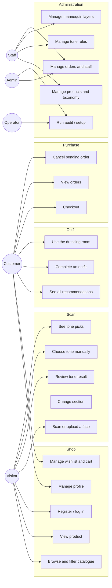

# Chapter 3 — Use Cases

## 3.1 Actors

| Actor | Description | Authentication |
| --- | --- | --- |
| Visitor | Browses the shop, scans a face and receives recommendations. | None |
| Customer | Registered shopper with a profile, cart and orders. | Shopper session |
| Staff member | Employee with permissions for products, orders, tone rules or mannequin. | Separate admin session |
| Admin | Staff member with all permissions and team management. | Admin session |
| Scheduler / operator | Runs setup, seed, audit and test commands. | Local terminal |

## 3.2 Use-case overview

## 3.3 UC-01: Scan a face and reach a tone result

**Primary actor:** Visitor
**Preconditions:** The storefront and API are running; camera/upload is available.
**Trigger:** The shopper opens `/scanner` and starts a camera scan or uploads a photo.

**Main success scenario**

1. The scanner opens the camera or accepts one image.
2. For a camera scan, six frames are captured about 350 ms apart.
3. The server resizes each frame, finds face landmarks and applies the photo-quality gate.
4. Frames that fail are discarded with a reason; usable frames are measured for ITA, hue and Monk tone.
5. The scanner combines usable frames into a depth, undertone and confidence.
6. The face crop is classified for a men's/women's section suggestion.
7. The analysing screen stays for at least 2.2 seconds.
8. A section at 60% confidence or above opens `/scanner/result`; otherwise the scanner asks one question.
9. The result page shows tone, undertone, confidence word and four product groups.

**Alternatives**

- **No face:** API returns 422; the scanner shows “No face found…” and the manual tone picker.
- **Poor light/blur/pose:** 422 with the failed quality check and the specific retake instruction.
- **Server unavailable:** the scanner stays on `/scanner` and says the scanner is not ready.
- **Low gender confidence:** the shopper chooses Men or Women; no result is opened by guessing.

**Postconditions:** A `SavedScan` exists in local storage; signed-in users may also have a stored skin tone.

## 3.4 UC-02: Choose a tone manually

**Primary actor:** Visitor
**Preconditions:** Scanner page open; the photo path is unavailable or rejected.
**Trigger:** “Skip, pick my tone”.

1. The panel asks for depth (Fair/Medium/Dark), undertone (warm/cool/neutral) and section (Men/Women).
2. The client posts `/api/scanner/manual/`.
3. The server validates the values, records the scan and returns the palette.
4. The client saves the scan and opens `/scanner/result`.

**Alternatives:** invalid values return 400; the panel keeps the shopper's inputs and shows the error.

## 3.5 UC-03: Review and correct a result

**Primary actor:** Visitor
**Preconditions:** A saved scan exists.
**Trigger:** `/scanner/result` loads.

1. The header shows the tone, swatch, undertone, confidence word, Monk number and section.
2. The section card shows whether the section was auto-detected or chosen, with reasons.
3. “Change section” switches Men/Women in place and refreshes the picks.
4. “Not right? Choose mine” switches tone in place and refreshes the picks.
5. Reloading the page restores the stored scan. Without a scan the page redirects to `/scanner`.

## 3.6 UC-04: Browse tone picks and open a product

**Primary actor:** Visitor
**Preconditions:** A tone and section are known.

1. The page requests `GET /api/recommendations/tone-picks/?tone=…&gender=…&undertone=…`.
2. The server filters active, in-stock adult products for that gender (plus unisex) and tone (exact or All).
3. Four groups are ranked by palette, colour-family variety and mannequin readiness.
4. Each card shows the product photo, name, price and colour.
5. The main card opens `/product/{id}`; “Try on mannequin” opens `/mannequin?gender=…&skin=…`.

**Postconditions:** The shopper can add the item to the cart or continue to all matches.

## 3.7 UC-05: Complete an outfit

**Primary actor:** Customer or visitor
**Preconditions:** A product is open or a recommendation card is selected.

1. The shopper chooses “Complete outfit”.
2. The server reads the anchor's slot, kind, gender and colour.
3. The look engine fills top/bottom/shoes/accessories using formality, palette and style rules.
4. The page shows each slot with a reason and allows swapping.
5. The shopper can add the look to the cart.

**Alternatives:** A one-piece anchor (kurta/kameez/dress) covers its own slot and is not duplicated; missing slots are left empty rather than invented.

## 3.8 UC-06: Use the dressing room

**Primary actor:** Visitor
**Preconditions:** Mannequin bases and approved layers exist.

1. The shopper opens `/mannequin` or follows a “Try on mannequin” link.
2. Gender and skin are taken from the URL, profile or defaults.
3. The wardrobe API returns the base, skins and available layers.
4. The selected layers are stacked in z-order over the base.
5. Missing fair/dark variants fall back to the wheatish layer.

## 3.9 UC-07: Checkout and order history

**Primary actor:** Customer

1. The shopper reviews the cart and proceeds to checkout.
2. The server validates stock and prices, creates an order and order items in a transaction, and decrements stock.
3. Cash on delivery or demo card is recorded.
4. The shopper sees order confirmation and later the order list/detail.
5. A Pending order can be cancelled by its owner.

**Alternatives:** stock changed → 409 with a clear message; invalid coupon/payment → 400.

## 3.10 UC-08: Admin maintenance

**Primary actor:** Staff/Admin

- Add or edit a product, assign category, gender, slot, kind, tone compatibility and sizes.
- Add categories, colours and styles.
- Edit the skin-tone matrix: depth × undertone → colour score.
- Upload, hide or delete mannequin layers.
- Move an order through Pending → Confirmed → Shipped → Delivered or Cancelled.
- Create roles and team members with explicit permissions.

**Permission failure:** The API returns 403; the UI also hides actions the role cannot use.

## 3.11 UC-09: Operational audit

**Primary actor:** Operator

1. Run `npm run setup` to prepare a machine.
2. Run `apps/server/venv/bin/python apps/server/manage.py audit_tone_picks`.
3. The command prints eligible counts and the two selected names for every gender × tone × group.
4. The command never writes to the database.

## 3.12 Use-case-to-requirement map

| Use case | Requirements |
| --- | --- |
| UC-01 Scan | FR-05, FR-06, FR-07, FR-09, FR-11 |
| UC-02 Manual tone | FR-08 |
| UC-03 Review/correct | FR-10, FR-12–FR-14 |
| UC-04 Tone picks | FR-17–FR-19 |
| UC-05 Complete outfit | FR-20 |
| UC-06 Dressing room | FR-21 |
| UC-07 Checkout | FR-22–FR-24 |
| UC-08 Admin | FR-25–FR-27 |
| UC-09 Audit | FR-28–FR-30 |
