# Chapter 4 — System Design

## 4.1 Design goals

- Keep skin-tone and recommendation science independent of Django so it can be unit-tested.
- Keep HTTP views thin: validate input, call a service, serialise output.
- Make every rule staff-editable where practical (categories, colours, styles, tone scores, mannequin layers).
- Degrade gracefully: a missing model, photo, mannequin layer or catalogue group must not break the journey.
- Work on a CPU-only demo laptop and a phone-width browser.

## 4.2 High-level architecture

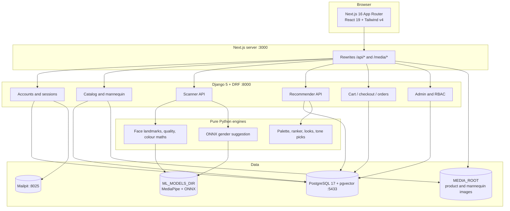

**Rule:** the browser never calls Django directly; it uses the Next.js rewrite, so cookies remain on one origin.

## 4.3 Domain model

### 4.3.1 Entity–relationship diagram

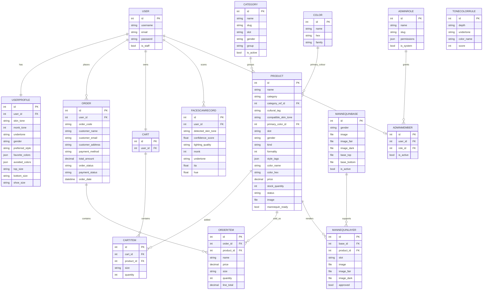

### 4.3.2 Data dictionary

The tables below summarise every persisted model. Common timestamps (`created_at`, `updated_at`) are present on all core models and omitted where they add noise.

#### Accounts — `UserProfile`

| Field | Type | Notes |
| --- | --- | --- |
| id | bigint PK | |
| user | one-to-one → User | One profile per account. |
| skin_tone | char | Fair / Medium / Dark. |
| monk_tone | small int | 0–10; 0/empty when unknown. |
| undertone | char | warm / cool / neutral. |
| cultural_preference | char | Style name such as Western. |
| gender | char | male / female / unspecified. Used only to prefill; auto suggestion is separate. |
| preferred_style | char | casual / formal / eastern. |
| favorite_colors | JSON | Optional preference list. |
| avoided_colors | JSON | Used by the ranker. |
| body_preset | char | slim / regular / plus. |
| top_size, bottom_size, shoe_size | char | Size availability checks. |

#### Catalog — `Product`

| Field | Type | Notes |
| --- | --- | --- |
| id | bigint PK | |
| name, slug | char | Display and URL name. |
| description | text | Product copy. |
| category | char | Legacy category name kept for compatibility. |
| category_ref | FK → Category | Preferred category link. |
| cultural_tag | char | Casual / Formal / Eastern style. |
| style | char | Legacy style field. |
| compatible_skin_tone | char | Fair / Medium / Dark / All. |
| color | char | Legacy colour name. |
| primary_color | FK → Color | Structured colour. |
| garment_type | char | Legacy coarse type. |
| image | file | Product photo under `MEDIA_ROOT`. |
| cost_price, price | decimal | Cost and selling price. |
| stock_quantity | positive int | Total stock. |
| size_s_stock … size_xxl_stock | positive int | Per-size stock. |
| sizes | JSON | Size availability map. |
| status | char | Active / Inactive / Out of Stock / Draft. |
| is_active | bool | Shop visibility flag. |
| external_id | char | Import identifier. |
| slot | char | top / bottom / kurta / outerwear / footwear / accessory / dupatta. |
| gender | char | men / women / unisex. |
| kind | char | 24 garment kinds: tshirt, shirt, polo, kurta, kameez, jacket, blazer, waistcoat, hoodie, jeans, trousers, shorts, shalwar, sneakers, formal_shoes, sandals, boots, watch, belt, tie, cap, sunglasses, bag, dupatta, dress. |
| formality | small int | 1–5, 0 when unknown. |
| style_tags | JSON | Style names for matching. |
| color_name, color_hex | char | Display fallback and palette input. |
| color_palette | JSON | Optional extracted colours. |
| mannequin_image, back_image | file | Optional mannequin assets. |
| mannequin_ready | bool | Layer exists and is drawable. |
| mannequin_note | char | Why a layer was rejected. |

#### Catalog — `Category`, `Color`, `Style`

| Model | Fields |
| --- | --- |
| Category | id, name, slug, slot, gender, group, image, sort_order, is_active |
| Color | id, name, hex, family (white/black/grey/brown/blue/green/red/pink-purple) |
| Style | id, name, slug, sort_order, is_active |

#### Mannequin — `MannequinBase`, `MannequinLayer`

| Model | Fields |
| --- | --- |
| MannequinBase | id, gender (men/women), image, base_top, base_bottom, image_fair, image_dark, width, height, label, source_sha, is_active |
| MannequinLayer | id, base FK, product FK, slot (top/kurta/outerwear/bottom/shoes/watch/eyewear/headwear), image, image_fair, image_dark, source, source_sha, report JSON, approved, note |

#### Orders — `Cart`, `CartItem`, `Order`, `OrderItem`

| Model | Fields |
| --- | --- |
| Cart | id, user one-to-one |
| CartItem | id, cart FK, product FK, size, quantity |
| Order | id, user FK, order_code, customer_name/email/phone/address, city, payment_method, product (legacy), quantity, total_amount, profit_amount, order_status, payment_status, order_date |
| OrderItem | id, order FK, product FK, name, price, size, quantity, line_total |

#### Scanner — `FaceScanRecord`

| Field | Type | Notes |
| --- | --- | --- |
| id | bigint PK | |
| user | FK → User, nullable | Null for a guest scan. |
| visitor_name | char | Optional label. |
| detected_skin_tone | char | Fair / Medium / Dark / Rescan Required / Unknown. |
| confidence_score | float | 0–100. |
| lighting_quality | char | Good / Normal / Low / Too Bright / Too Low. |
| brightness | float | Mean face luminance. |
| monk | small int | Monk swatch 1–10, 0 when unknown. |
| undertone | char | warm / cool / neutral. |
| ita, hue | float | Measurement inputs. |

No photo is stored.

#### Recommender — `ToneColorRule`

| Field | Type | Notes |
| --- | --- | --- |
| depth | char | Fair / Medium / Dark. |
| undertone | char | warm / cool / neutral. |
| color_name | char | Reference colour name. |
| score | small int | +2 best, +1 good, −2 avoid. |

#### Staff — `AdminRole`, `AdminMember`

| Model | Fields |
| --- | --- |
| AdminRole | id, name, slug, description, permissions JSON, is_system |
| AdminMember | id, user one-to-one, role FK, is_active |

#### Legacy

`Booking` remains in the database for historical rows but the admin Bookings section and booking permissions were removed. New bookings are not part of the current journey.

## 4.4 Class diagram

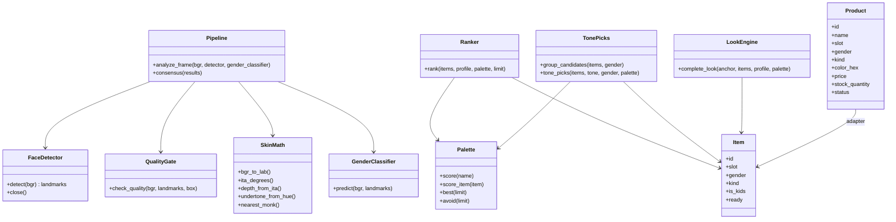

## 4.5 Sequence diagrams

### 4.5.1 Photo scan

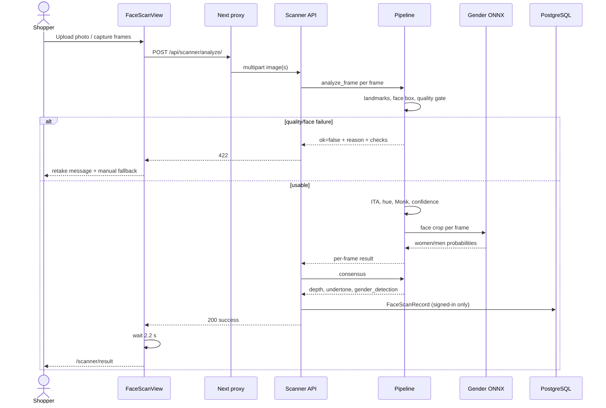

### 4.5.2 Tone picks

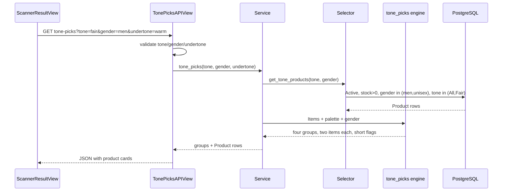

### 4.5.3 Checkout

```mermaid
sequenceDiagram
  actor C as Customer
  participant UI as Checkout page
  participant API as CheckoutAPIView
  participant S as checkout service
  participant DB as PostgreSQL

  C->>UI: Place order
  UI->>API: POST /api/checkout/
  API->>S: validate cart + customer details
  S->>DB: BEGIN; lock products
  S->>DB: check stock and price
  S->>DB: create Order + OrderItems
  S->>DB: decrement stock
  S->>DB: clear cart
  S->>DB: COMMIT
  API-->>UI: order id/code
  UI-->>C: Confirmation
```

## 4.6 Operation contracts

### Contract: `analyze_face_images`

- **Input:** one or more uploaded images; optional signed-in user.
- **Preconditions:** image decodes; scanner model available.
- **Postconditions:** returns per-frame measurements, consensus, palette and optional gender suggestion; a successful signed-in scan may create a `FaceScanRecord` and update profile tone. No photo is stored.
- **Failure:** `ScannerUnavailable` → 503; unusable photo → 422 with reason and quality checks.

### Contract: `tone_picks(tone, gender, undertone)`

- **Input:** tone ∈ Fair/Medium/Dark; gender ∈ men/women; undertone optional.
- **Preconditions:** none beyond valid input.
- **Postconditions:** returns four groups in display order; each group has 0–2 products; `short_groups` lists groups with fewer than two; no product outside the gender or tone filter.
- **Invariants:** deterministic for the same catalogue, palette and input; gender is never relaxed.

### Contract: `complete_look(anchor, items, profile, palette)`

- **Input:** anchor item, eligible items, shopper profile, palette.
- **Postconditions:** fills missing slots with compatible items; never duplicates the anchor slot; returns reasons and total.
- **Invariants:** kids products never enter adult looks; gender compatibility is enforced.

### Contract: `checkout(cart, customer)`

- **Preconditions:** authenticated cart owner; non-empty cart.
- **Postconditions:** exactly one order, one item per cart line, stock decremented atomically, cart cleared.
- **Failure:** insufficient stock → no partial order; transaction rolls back.

## 4.7 Activity diagram — scan journey

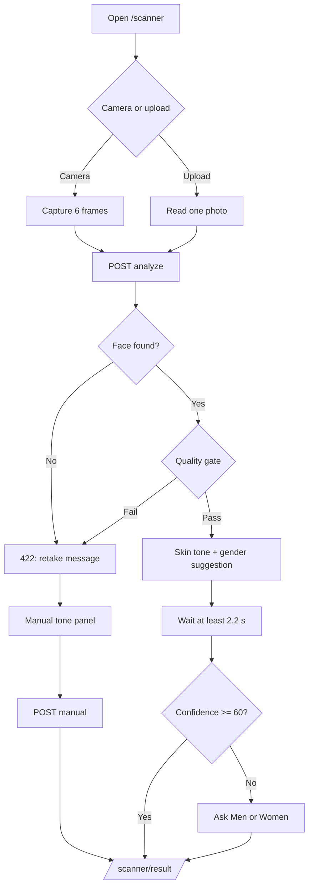

## 4.8 State diagrams

### 4.8.1 Scanner state

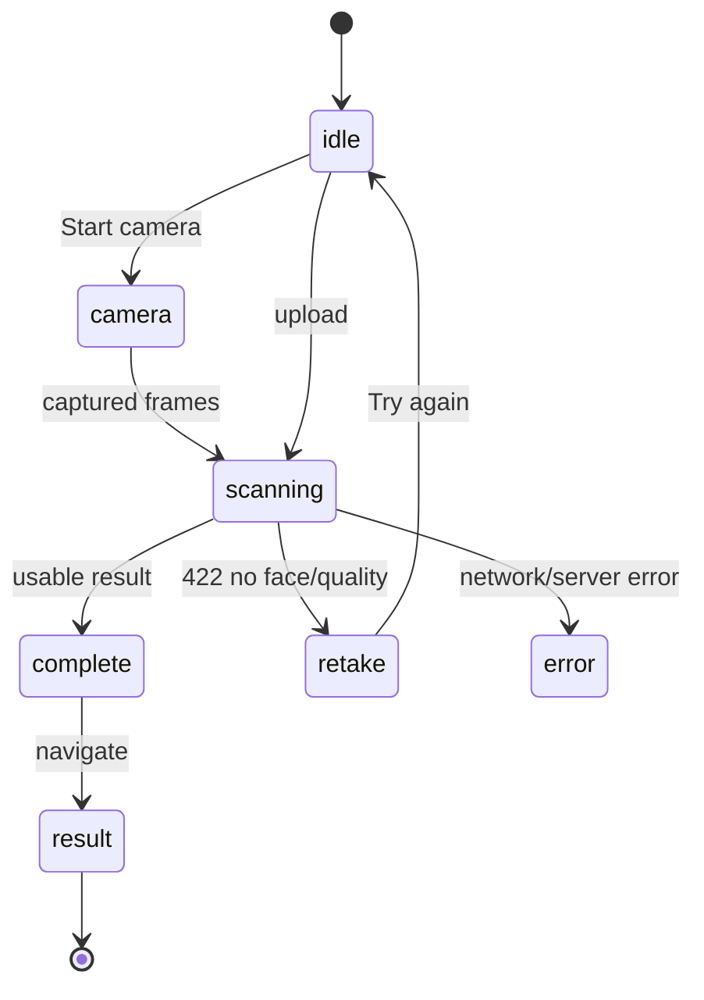

### 4.8.2 Order state

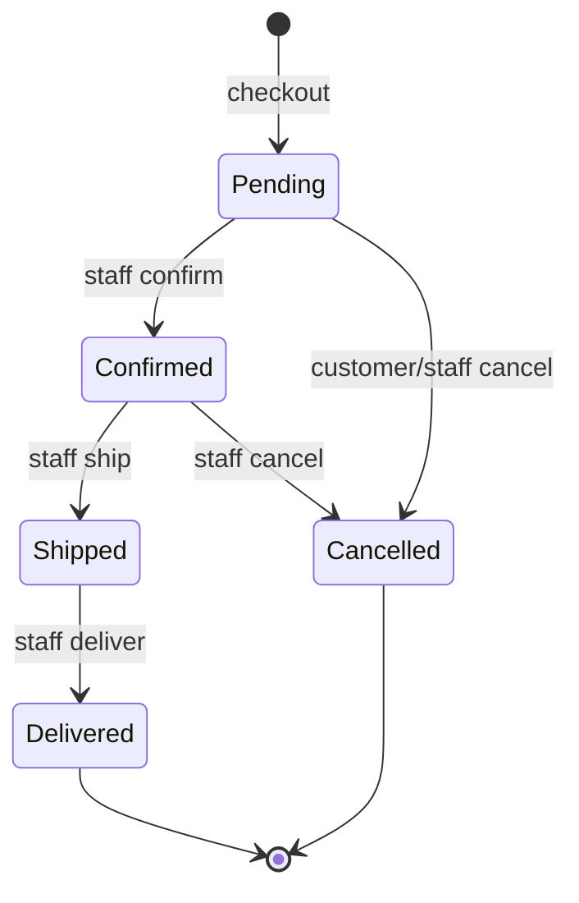

## 4.9 Component diagram

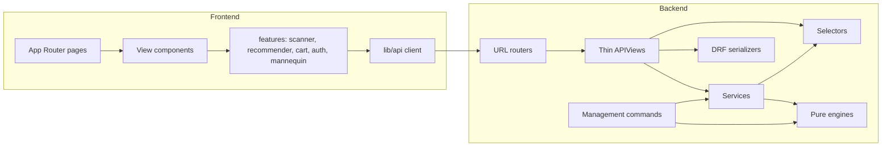

## 4.10 Deployment diagram

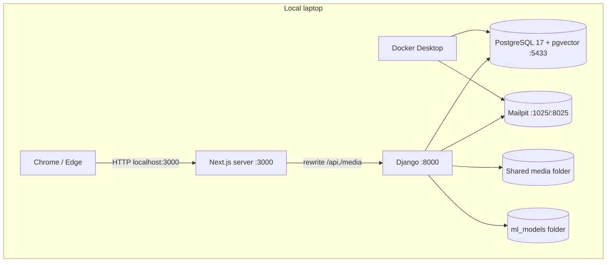

No cloud, HTTPS or public DNS is configured. The demo is intentionally local.

## 4.11 Data-flow diagrams

### Level 0 (context)

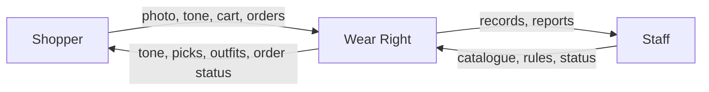

### Level 1

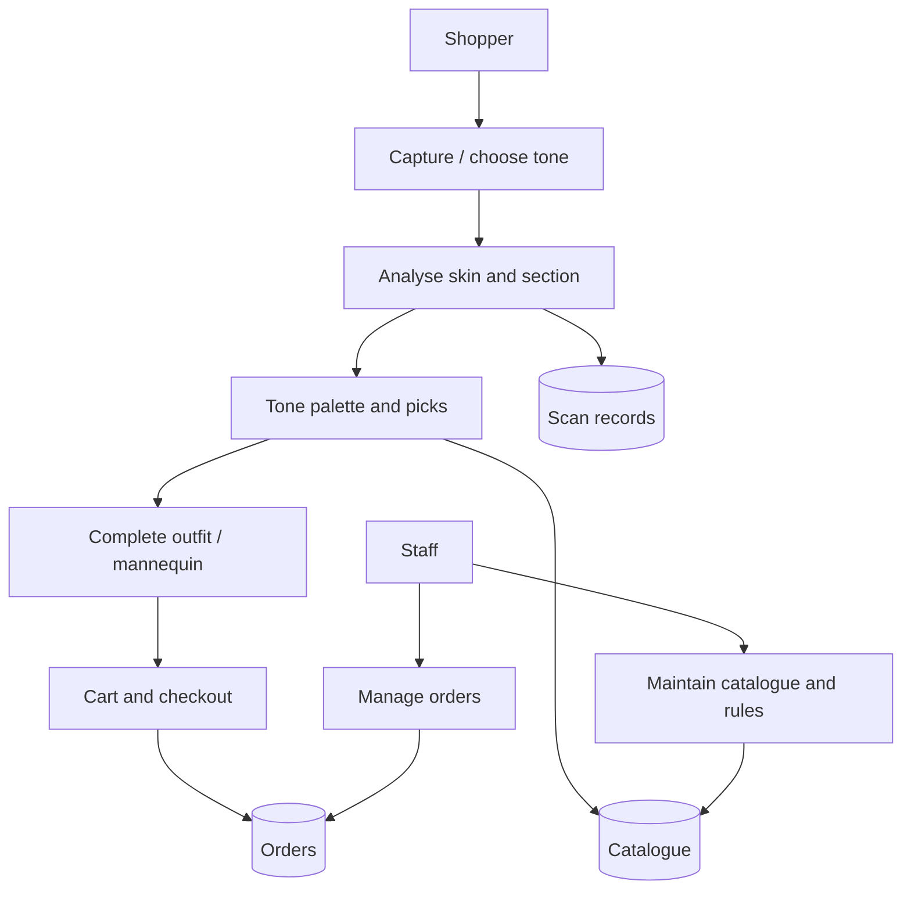

### Level 2 — scan detail

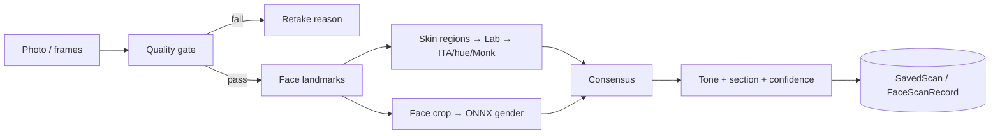

## 4.12 Design decisions and trade-offs

| Decision | Why | Trade-off |
| --- | --- | --- |
| Pure Python engines | Fast unit tests, no DB needed. | Adapter must translate Django Products. |
| Next rewrite proxy | Same-origin cookies, no CORS. | Next must be running for `/api`. |
| Local storage for scan | Result survives reload without an account. | Per-browser, not synced. |
| Appearance-based gender suggestion | Avoids forcing every shopper to answer. | Binary, imperfect; always overridable. |
| Product `kind` separate from `slot` | Caps/glasses live in accessory but need their own group. | Some imported rows are mis-tagged; guarded by name. |
| Shared external media | Keeps 1.4 GB of photos out of git. | Setup must configure `MEDIA_ROOT`. |
| Short groups, not invented products | Honest catalogue behaviour. | Some groups may show fewer than two items. |
